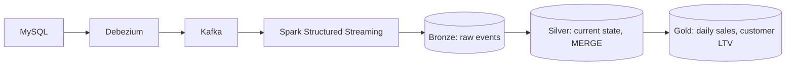

# CDC Lakehouse Pipeline

Real-time pipeline that captures every insert, update, and delete from a MySQL database and turns them into analytics-ready Delta Lake tables using a bronze/silver/gold (medallion) design.

## Architecture

## Tech stack

| Layer | Tool |
|---|---|
| Source database | MySQL 8 (binlog, ROW format) |
| CDC | Debezium 2.7 |
| Message broker | Apache Kafka 3.7 (KRaft) |
| Processing | PySpark 3.5 Structured Streaming |
| Storage | Delta Lake 3.2 |
| Packaging | Docker Compose |

## How to run

1. `docker compose up -d`
2. Register the connector:
   `curl -i -X POST -H 'Content-Type: application/json' localhost:8083/connectors -d @connector/mysql-connector.json`
3. Start the data generator: `python data_generator/generator.py`
4. `./submit.sh bronze.py`
5. `./submit.sh silver.py`
6. `./submit.sh gold.py`
7. Optional demo: `./submit.sh delta_demo.py`

## Design decisions

- **CDC instead of batch:** low latency, captures deletes, no heavy queries on the source.
- **Bronze keeps raw events:** silver can be rebuilt after a bug or a logic change.
- **Latest event per key by Kafka offset:** Debezium sends one key to one partition, so the offset is the true order.
- **Delta MERGE:** handles insert, update, and delete in one idempotent step.
- **Checkpoints:** restarts do not duplicate or lose data.

## Future work

Airflow scheduling, data quality checks, a dashboard, CI tests, schema evolution.
